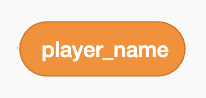
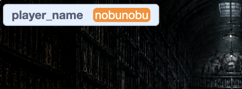
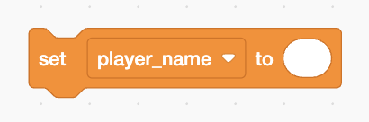
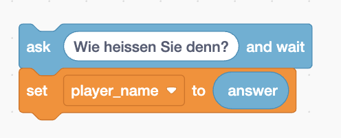
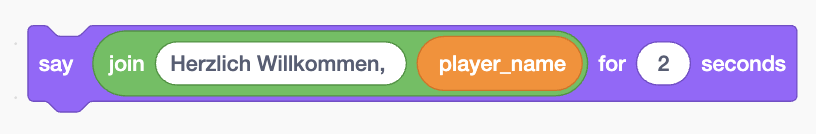
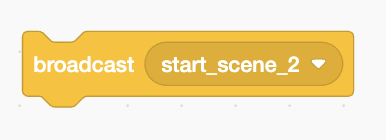
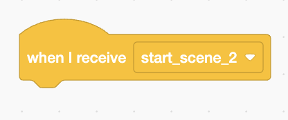

---

marp: true
theme: gaia
paginate: true

style: |
  :root {
    --color-background: #111318;
    --color-foreground: #e7e9ee;
    --color-highlight: #a99cff;
    --color-highlight-hover: #c9bfff;
    --color-highlight-heading: #c9bfff;
    --color-header: #737985;
    --color-footer: #737985;
  }

  section {
    background-color: #111318;
    color: #e7e9ee;
    font-family: "Helvetica Neue", Arial, sans-serif;
    padding: 42px 56px;
    font-size: 27px;
    display: flex;
    flex-direction: column;
    justify-content: center;
  }

  h1 {
    color: #c9bfff;
  }

  h2 {
    color: #ffffff;
  }

  h3 {
    color: #d7d9e0;
  }

  section.title {
  text-align: center;
  }

  strong {
    color: #ffb45c;
  }

  blockquote {
    background: #1b1e26;
    border-left: 5px solid #8f7cff;
    color: #f2f3f7;
    border-radius: 8px;
    padding: 14px 20px;
  }

  code {
    background: #252934;
    color: #ffc978;
    padding: 2px 6px;
    border-radius: 5px;
  }

  pre {
    background: #090b0f;
    color: #e8e8e8;
    border: 1px solid #292d38;
    border-radius: 10px;
    padding: 17px 20px;
    font-size: 0.72em;
  }

  pre code {
    background: transparent;
    color: inherit;
  }

  .box {
    background: #1a1d24;
    border: 1px solid #30343f;
    border-radius: 10px;
    padding: 14px 18px;
    margin: 14px 0;
  }

  section.chapter {
    background: #16131f;
    text-align: center;
    display: flex;
    flex-direction: column;
    justify-content: center;
  }

  section.chapter h1 {
    color: #ffffff;
    font-size: 2.2em;
  }

  section.chapter h2 {
    color: #a99cff;
  }

  section.title {
    background: #0b0d12;
    text-align: center;
    display: flex;
    flex-direction: column;
    justify-content: center;
  }

  section.title h1 {
    color: #ffffff;
    font-size: 2.35em;
  }

  section.title h2 {
    color: #a99cff;
  }

---

<!-- _class: title -->
<!-- _paginate: false -->

# Scratch Workshop

## Teil 2 · Variablen & Broadcast

**Fortgeschrittene Konzepte**

<small>Nobu · Scratch - Einstieg ins Gameprogrammieren</small>

---

# Rückblick

Im ersten Teil habt ihr gelernt:

* Sprites bewegen
* Hintergründe wechseln
* Dialoge verwenden
* Blöcke kombinieren

---

# Ziel für diesen Part

**Variablen**

Wie kann Scratch Informationen speichern?

**Broadcast**

Wie können Figuren miteinander kommunizieren?

---

<!-- _class: chapter -->

# Teil A

## Variablen

Merken · Verändern · Rechnen

---

# Was ist eine Variable?

> Eine Variable ist wie eine **Box mit einem Namen**.

In dieser Box kann Scratch einen Wert speichern.

Zum Beispiel:

* Punkte, Highscore
* Namen, Textstring
* Zeit

---

# Beispiele für Variablen

### Punkte

`Punkte = 12`

### Namen, Texte

`Text = "Scratch is toll"`

### Zeit

`Zeit = 45`

Der Wert kann sich während des Spiels verändern.

---

# Beispiel-Projekt

https://scratch.mit.edu/projects/1384788695/

Wir können in diesem Beispiel-Projekt konkret ansehen, wie man Variabel und Broadcast-Funktion verwendet. 

---

# Variable erstellen

1. Öffne **Variables**.
2. Klicke auf **„Make a Variable“**.
3. Gib ihr einen Namen.

Zum Beispiel:

`Punkte`

oder

`Text`

---

# Für wen gilt die Variable?

Scratch fragt:

**For all sprites?**

oder

**For this sprite only?**

 

In Scratch kann man festlegen, ob eine Variable für alle Figuren oder nur für eine bestimmte Figur verfügbar sein soll.

---

# Das ist ein Variabel

Der Wert eines Variabels kann sichtbar angezeigt werden:

---

# Werte für ein Variabel festsetzen & ändern

---

# Werte verwenden

---

<!-- _class: chapter -->

# Teil B

## Broadcast

Nachrichten zwischen Figuren

---

# Warum Broadcast?

Stellt euch vor:

**Um ein "Buch" aufzuklappen, muss man die "Leertaste" 10mal tippen**

Eine Figur "Bibliothkar" soll darauf reagieren.

Aber woher weiss der Bibliothekar, dass das Ziel erreicht wurde?

---

# Die Idee

> Ein Broadcast ist wie eine **Durchsage**.

Eine Figur sendet eine Nachricht.

Andere Figuren können auf diese Nachricht reagieren.

---

# Nachricht senden

Unter **Events** findet ihr:

Die Figur sendet damit die Nachricht:

**„start_scene_2“**

---

# Nachricht empfangen

Eine andere Figur kann darauf warten:

Danach führt sie ihre eigenen Blöcke aus.

---

# Konkretes Beispiel

[Hier in diesem Projekt](https://scratch.mit.edu/projects/1384788695)

---

# Zusammenfassung

**Variable**

Das **Gedächtnis** des Programms.

**Broadcast**

Die **Kommunikation** zwischen Figuren.

---

<!-- _class: chapter -->

# Jetzt seid ihr dran

